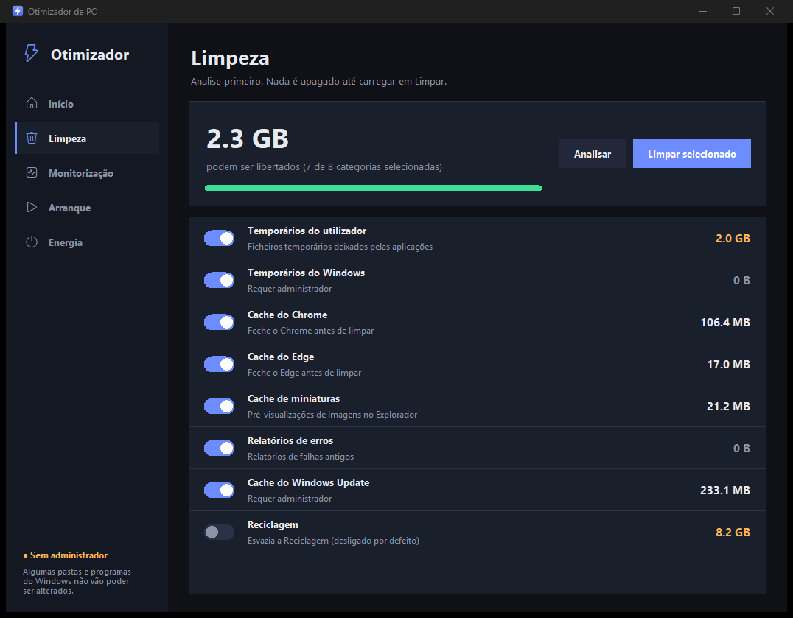
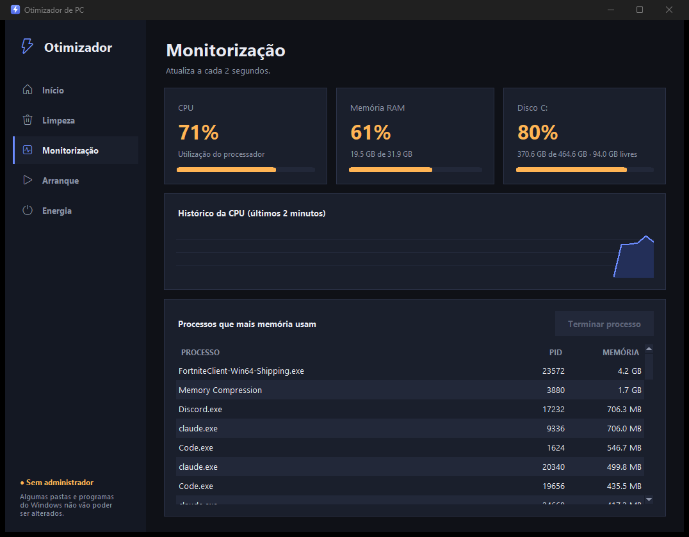

# Otimizador de PC

Pequena app para Windows que fiz para limpar ficheiros temporários, ver o que está a gastar recursos e
controlar os programas que abrem com o Windows.


## Download

Vai a [Releases](../../releases/latest), saca o `OtimizadorPC.exe` e abre. Não precisa de instalação.

O Windows pode mostrar o aviso "O Windows protegeu o seu PC" porque o exe não é assinado. É só clicar em
"Mais informações" e depois "Executar mesmo assim".

## O que faz

- Limpeza de temporários, cache do Chrome/Edge, miniaturas, relatórios de erros, cache do Windows Update e Reciclagem
- Botão "Otimizar tudo" que limpa só as coisas seguras (não mexe na Reciclagem nem no Windows Update)
- Monitorização de CPU, RAM, disco e processos
- Ligar/desligar programas de arranque (igual ao Gestor de Tarefas, não apaga nada)
- Trocar o plano de energia

Antes de apagar mostra sempre quanto espaço vai libertar e pede confirmação. Ficheiros em uso são ignorados.




## Correr a partir do código

Precisa de Python 3.12 ou mais recente. Não tem dependências.

```
py otimizador.py
```

Para gerar o exe:

```
powershell -ExecutionPolicy Bypass -File build.ps1
```


## Licença

MIT
