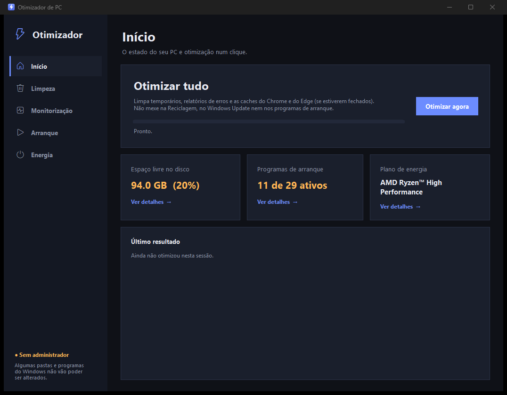

# Otimizador de PC

Pequena app para Windows que fiz para limpar ficheiros temporários, ver o que está a gastar recursos e
controlar os programas que abrem com o Windows.



## Download

Vai a [Releases](../../releases/latest), saca o `OtimizadorPC.exe` e abre. Não precisa de instalação.

O Windows pode mostrar o aviso "O Windows protegeu o seu PC" porque o exe não é assinado. É só clicar em
"Mais informações" e depois "Executar mesmo assim".

## O que faz

- Limpeza de temporários, cache do Chrome/Edge, miniaturas, relatórios de erros, cache do Windows Update e Reciclagem
- Botão "Otimizar tudo" que limpa só as coisas seguras (não mexe na Reciclagem nem no Windows Update)
- Monitorização de CPU, RAM, todos os discos e processos
- Analisador de espaço: mostra as pastas que mais ocupam em cada disco (só lê, não apaga nada)
- Página Sistema com o hardware do PC e recomendações (ex.: RAM abaixo da velocidade por ter o XMP/EXPO desligado,
  ecrã abaixo da taxa máxima, Modo de Jogo, saúde dos discos)
- Versão e idade do driver da placa gráfica, com link para a página oficial da AMD, NVIDIA ou Intel
- Modo Boost: fecha os programas escolhidos antes de jogar (como carregar no X), muda para Alto desempenho
  e volta a abrir tudo no fim
- Estimativa de FPS em jogos populares a partir da placa gráfica e do processador (é uma estimativa, não uma medição)
- Ligar/desligar programas de arranque (igual ao Gestor de Tarefas, não apaga nada)
- Trocar o plano de energia

Antes de apagar mostra sempre quanto espaço vai libertar e pede confirmação. Ficheiros em uso são ignorados.


## Correr a partir do código

Precisa de Python 3.12 ou mais recente. A interface é feita em HTML/CSS (pasta `ui`) e aberta com o
[pywebview](https://pywebview.flowrl.com), que usa o WebView2 que já vem com o Windows 10 e 11.

```
py -m pip install -r requirements.txt
py otimizador.py
```

Para gerar o exe:

```
powershell -ExecutionPolicy Bypass -File build.ps1
```


## Licença

MIT. As fontes Geist e Geist Mono (pasta `ui/fonts`) são da Vercel e usam a licença SIL Open Font License,
incluída em `ui/fonts/OFL.txt`.
